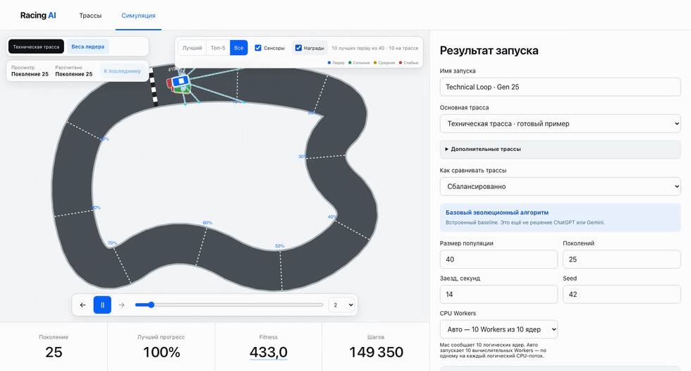
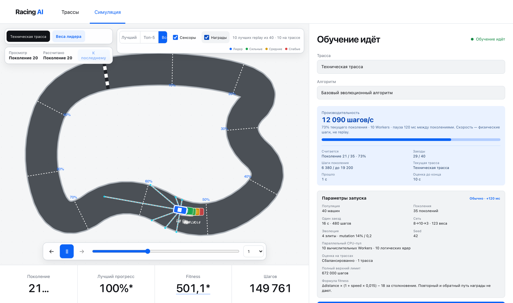
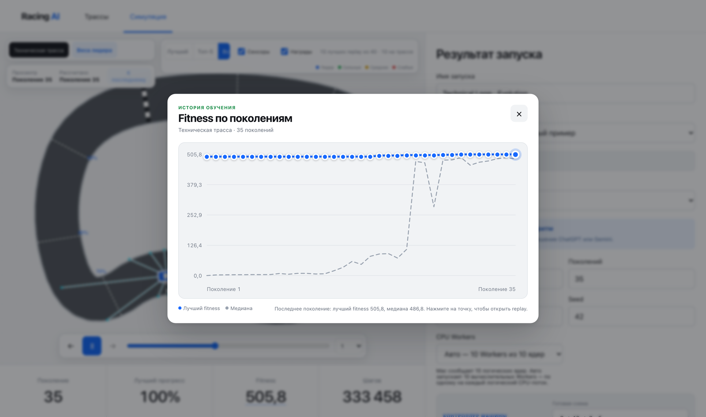
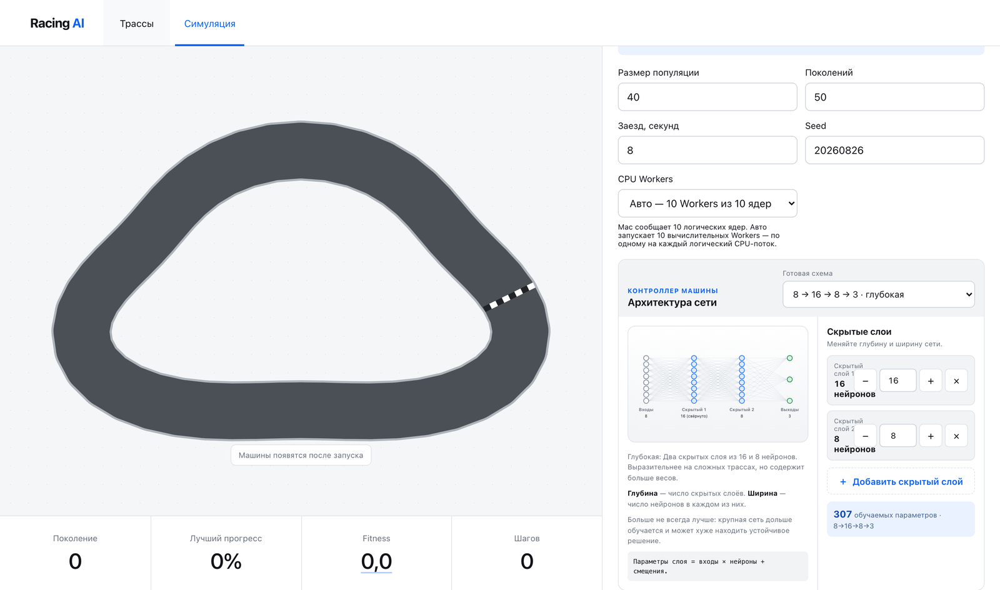
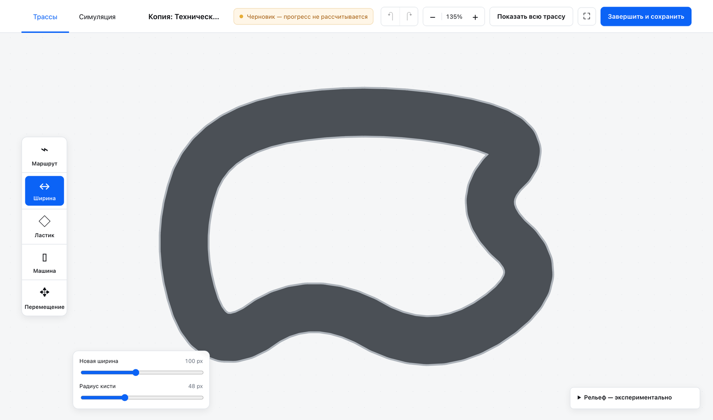

<div align="center">

**English** · [Русская версия](README.ru.md)

# Racing AI Lab

**Interactive 2D browser laboratory for training, replaying, and comparing evolutionary self-driving AI agents — built with pure JavaScript, HTML5 Canvas, and multi-core Web Workers.**

[](https://lemelson.github.io/racing-ai-lab/)
[](https://github.com/Lemelson/racing-ai-lab/actions/workflows/ci.yml)
[](package.json)
[](tests/)
[](LICENSE)

<h3>
  <a href="https://lemelson.github.io/racing-ai-lab/">▶ Launch Live Lab in Browser</a>
</h3>

<p>No install, no backend, no build step — draw your own track and evolve neural-network drivers right in your browser.</p>



</div>

---

## Why Racing AI Lab?

Inspired by commonLuke's video [*"Can I Build a Better Self-Driving AI Than Claude?"*](https://www.youtube.com/watch?v=GGWHjAyKJCA) (built completely from scratch without copying its code), **Racing AI Lab** turns viral self-driving demos into a **reproducible, verifiable neuroevolution sandbox**.

Typical self-driving demos look cool but rarely answer the hard experimental questions:

- Did every competing algorithm run under **identical physics, sensors, and tracks**?
- Is progress independent of **FPS, monitor refresh rate, or mouse drawing speed**?
- Can agents exploit the **fitness function** by looping or clipping through corners?
- Can you **reproduce an exact run** from its seed, inspect its weights, and replay any generation?
- How do agents generalize across **multiple tracks** instead of memorizing a single oval?

Racing AI Lab makes every one of those guarantees explicit, deterministic, and backed by **98 automated contract tests**.

> **Project Status:** Working browser-based 2D laboratory with track editor, multi-core Web Worker training, multi-track evaluation, decoupled replay, generation analytics, configurable neural networks, and local persistence. Independent competitor entries (`competitors/chatgpt`, `competitors/gemini`) are scaffolded as future benchmarks and are not mocked in the UI.

---

## Screenshots

<table>
  <tr>
    <td width="50%">
      
      <p align="center"><strong>Live Multi-Core Training &amp; Telemetry</strong><br/>10 parallel Web Workers (12,000–16,800+ steps/s), 7 cyan raycast sensors, 10% reward gates, and real-time generation progress.</p>
    </td>
    <td width="50%">
      
      <p align="center"><strong>Generation Fitness Analytics</strong><br/>Interactive Best vs. Median fitness curve — click any generation point to jump straight into its replay.</p>
    </td>
  </tr>
  <tr>
    <td width="50%">
      
      <p align="center"><strong>Configurable Neural Network Designer</strong><br/>Presets (<code>8→8→3</code>, <code>8→10→3</code>, <code>8→16→8→3</code>, <code>8→24→3</code>) or custom 1–3 hidden layers with live topology preview and exact weight counts.</p>
    </td>
    <td width="50%">
      
      <p align="center"><strong>Infinite 2D Track Editor</strong><br/>Multi-stroke uniform resampling, variable-width brush, true-gap eraser, elevation brush, and exact vehicle footprint check.</p>
    </td>
  </tr>
</table>

---

## Key Features

### Evolutionary Training & Multi-Core Web Workers
- **Seeded PRNG & Bit-Identical Determinism** — identical track, seed, and config always produce the exact same evolution trajectory regardless of worker finish order.
- **Automatic CPU Worker Pool** — detects `navigator.hardwareConcurrency` and spawns one evaluator Web Worker per logical core while keeping population ranking, elitism, crossover, and mutation centralized in the coordinator.
- **Multi-Track Generalization** — train simultaneously across multiple tracks with a shared seeded track order and three aggregation strategies: **Mean**, **Balanced**, or **Worst-Track**.
- **Anti-Exploit Fitness Scoring** — rewards verified forward distance and speed (`Δdistance × (1 + speed × 0.015) − 18` on crash); revisiting already-credited segments, driving backward, or cutting off-track yields zero progress.

**Measured Local Benchmark (Apple M1 Max, 40 cars, 1 track, 30s episodes):**

| Mode | Throughput | Speedup | Result Parity |
| --- | ---: | ---: | --- |
| 1 Worker | 3,264 steps/s | 1.0× | Baseline |
| 10 Workers (Auto) | **16,877 steps/s** | **~5.2×** | 100% identical fitness, progress & checkpoint |

### Deterministic 2D Vehicle Physics & 7-Ray Sensors
- Fixed-timestep 2D kinematics (`throttle`, `brake`, `steering`) decoupled from display FPS.
- Longitudinal acceleration responds to painted **track elevation grade**.
- Exact **`18 × 32 px`** vehicle body checked via **8 footprint perimeter points** — runs end on the first real corner excursion, never waiting for the center point to leave the road.
- **7 configurable raycast sensors** returning normalized wall distances plus normalized speed (8 inputs total).

### Configurable Feed-Forward Neural Network
Each car is controlled by a `tanh`-activated feed-forward network taking **8 inputs** (7 sensor ray distances + normalized speed) and outputting **3 continuous controls** (`steering`, `throttle`, `brake`):

- Built-in presets: `8 → 8 → 3` (compact), `8 → 10 → 3` (baseline), `8 → 16 → 8 → 3` (deep), `8 → 24 → 3` (wide).
- Custom topology builder: **1 to 3 hidden layers**, **4 to 64 neurons per layer**.
- Live SVG network visualizer and exact trainable parameter count (`weights + biases`) before launch.

### Infinite 2D Track Editor
- Pan, zoom, fit-to-track, undo/redo, and fullscreen mode.
- Multi-stroke drawing with **uniform arc-length resampling** (immune to fast/slow mouse movement) and explicit loop closure.
- **Variable road-width brush** with visible radius, **true-gap eraser** (with bridge-stroke reconnection), **experimental elevation brush**, and on-track **vehicle footprint gauge**.
- Unified road geometry contract (union of tapered segments + circular joints) shared by both the renderer and collision engine — zero false triangular gaps on tight inner corners.
- Three built-in tracks: **Simple Oval**, **Hill Circuit**, and **Technical Loop**, plus immutable versioning for your custom tracks.

### Decoupled Replay, Inspection & Local Persistence
- Smooth frame-interpolated playback (`0.5×`, `1×`, `2×`, `4×`) independent of active training — pause training or scrub older generations without interrupting the worker pool.
- View modes: **Best**, **Top-5**, or **All** agents — tracked leader in **blue**, alternatives color-graded from **green → yellow → red**.
- Toggleable **7-ray sensors**, **10% progress reward gates**, and **leader weight inspector**.
- Save named runs (config, immutable track versions, seed, network architecture, champion weights, and generation replays) locally in browser `localStorage` — zero accounts, zero telemetry, zero servers.

---

## Fair Comparison Protocol

| Guarantee | Enforcement |
| --- | --- |
| Identical physics | Every agent runs inside the same fixed-timestep simulation core |
| Identical sensors | Shared 7-ray + speed normalized observation contract |
| Identical tracks | Immutable versioned track definitions locked into each run |
| Equal compute budget | Counts actual executed physical simulation steps, not wall-clock time |
| Reproducibility | Seed, config, network topology, checkpoint, and replay saved together |
| Multi-track fairness | Same seeded track ordering applied across every genome in a generation |
| Anti-exploit scoring | Off-track movement, reverse driving, and finish-line jumps earn zero credit |
| Verified invariants | Core physics, geometry, evolution, and worker contracts covered by 98 unit tests |

Full experimental protocol: [docs/04-experiment-rules.md](docs/04-experiment-rules.md).

---

## Quick Start

### Option 1 — Run Immediately in Your Browser
Open the live GitHub Pages deployment (no installation needed):

👉 **[https://lemelson.github.io/racing-ai-lab/](https://lemelson.github.io/racing-ai-lab/)**

### Option 2 — Run Locally

**Requirements:** Node.js `>= 20` and a modern browser with HTML5 Canvas, Module Web Workers, and `structuredClone`. Zero `npm install` needed — there are no external runtime dependencies.

```bash
git clone https://github.com/Lemelson/racing-ai-lab.git
cd racing-ai-lab
npm start
```

Open `http://127.0.0.1:4173` (or pick a custom port with `PORT=4174 npm start`). The built-in dev server disables HTTP caching and auto-reloads open tabs on code edits (deferring reload if you have an active track draft open).

### Run Checks & Tests

```bash
npm run check   # Syntax validation across all ES modules
npm test        # Runs all 98 Node.js test runner specs
```

---

## Architecture

```text
Track Editor ──▶ Immutable versioned track definitions
                        │
                        ▼
UI Thread ─────▶ training-worker.js ─────▶ Evolution Coordinator
    │                    │                        │
    │                    ▼                        ▼
    │          Evaluator Worker Pool      Ranking + Crossover + Mutation
    │              │     │     │                  │
    │              ▼     ▼     ▼                  ▼
    └─── Smooth Replay ◀──── Generation Artifacts & Telemetry
                │
                ▼
     Fitness Chart · Agents · 7-Ray Sensors · Weight Inspector
```

### Core Modules

| Path | Responsibility |
| --- | --- |
| `src/app.js` | UI views, track editor, Canvas renderer, replay player & run orchestration |
| `src/training-worker.js` | Generation coordinator and multi-core Web Worker pool manager |
| `src/training-evaluator-worker.js` | Parallel batch evaluation of genomes across compiled tracks |
| `src/core/course.js` | Track compilation, centerline projection, progress tracking & raycasting |
| `src/core/road-surface.js` | Unified variable-width road geometry for rendering & collision |
| `src/core/vehicle.js` | Deterministic 2D vehicle kinematics and 8-point footprint checks |
| `src/core/sensors.js` | Configurable 7-ray sensor rig and normalized observations |
| `src/core/network.js` | Feed-forward neural network inference (`tanh`) |
| `src/core/network-architecture.js` | Presets, custom layer validation, and exact parameter counting |
| `src/core/evolution.js` | Seeded PRNG, elitism, crossover, and Gaussian mutation |
| `src/core/fitness.js` | Verifiable anti-exploit fitness scoring |
| `src/core/training.js` | Multi-track population evaluation and aggregation |
| `src/core/training-pool.js` | Dynamic CPU core sizing and balanced task queue scheduling |
| `src/core/training-analysis.js` | Per-track leaderboards, fitness history & live ETA telemetry |
| `src/core/replay.js` | Smooth sub-step interpolation and generation replay history |
| `src/core/catalog.js` | Local persistence for versioned tracks and saved runs |

---

## Repository Structure

```text
.
├── index.html            # Application shell & interactive views
├── src/                  # Vanilla JS UI, Web Workers & deterministic simulation core
├── tests/                # 98 automated Node.js unit & contract tests
├── scripts/serve.mjs     # Zero-dependency local dev server with live reload
├── docs/                 # Architecture specs, experiment rules & media assets
├── competitors/          # Future independent AI competitor workspaces (ChatGPT, Gemini)
├── public/assets/        # Safe static visual assets
└── references/           # UI design concepts & research notes
```

---

## Documentation & Roadmap

- [01 — Intent and Understanding](docs/01-intent-and-understanding.md) *(RU)*
- [02 — Video Breakdown](docs/02-video-breakdown.md) *(RU)*
- [03 — Proposed Architecture](docs/03-proposed-architecture.md) *(RU)*
- [04 — Fair Experiment Rules](docs/04-experiment-rules.md) *(RU)*
- [05 — Open Questions](docs/05-open-questions.md) *(RU)*
- [06 — MVP Implementation Notes](docs/06-mvp-implementation.md) *(RU)*

**Planned Next Steps:**
1. JSON export/import for tracks, checkpoints, and replays.
2. Versioned participant contract for head-to-head AI model benchmarks (ChatGPT, Gemini, Claude).
3. Held-out validation track suites and multi-seed statistical runs.
4. Compute backend benchmarks (JS Workers vs. Rust/WASM vs. native Apple Silicon / MLX).
5. Headless CLI training runner and optional 3D elevation rendering on top of the same core contracts.

---

## Privacy & Disclaimer

- Runs **100% client-side** in your browser — no account, no analytics, no external API calls.
- Saved tracks and runs live strictly in your browser's `localStorage`.
- Created as a personal educational and experimental neuroevolution lab. Not affiliated with commonLuke, OpenAI, Google, or any automotive manufacturer. Results are strictly for simulation research.

## License

Released under the [MIT License](LICENSE) © 2026 Artyom Lemelson.
