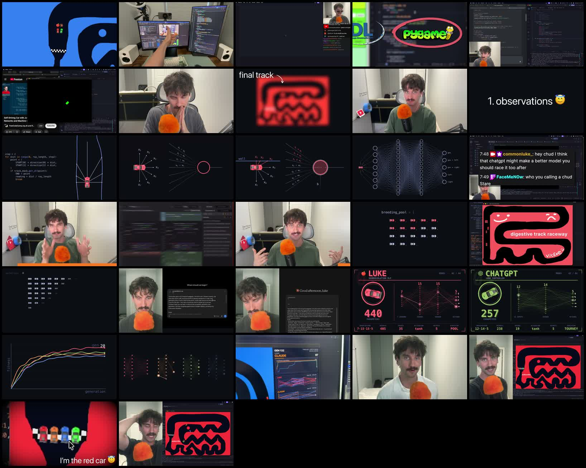

# Что происходит в ролике

Источник: commonLuke, [«Can I Make a Better AI Than AI?»](https://www.youtube.com/watch?v=GGWHjAyKJCA), 16:15, опубликован 25 августа 2026 года. Таймкоды ниже округлены.

## Короткая версия

Автор на Python и Pygame делает 2D-гоночную среду, вручную создаёт маленькую полносвязную нейросеть и обучает её генетическим алгоритмом. Затем он даёт ChatGPT, Claude и Gemini одинаковый репозиторий без водительского AI и одинаковый общий prompt. Каждая LLM пишет собственный обучаемый контроллер. Все четыре популяции обучаются на общих трассах, после чего лучшие машины едут по незнакомой сложной трассе. Ручная реализация автора оказывается единственной, которая финиширует.

Это развлекательная демонстрация, а не строгий научный benchmark: один финальный заезд и один случайный процесс обучения не позволяют надёжно утверждать, что одна LLM или архитектура в целом лучше другой.

## Ход ролика

| Примерное время | Что происходит | Что важно для нашего проекта |
|---|---|---|
| 00:00–01:10 | Показываются две управляемые AI машины: ручная реализация автора и код Claude. Автор формулирует вопрос о ценности самостоятельного обучения в эпоху LLM. | Гонка — визуальная оболочка эксперимента «человек против кода LLM». |
| 01:10–02:00 | План: сделать игру, придумать модель и создать среду обучения. Выбран Python и Pygame. Цикл делится на input, physics update и render. | Само разделение полезно, но для быстрой тренировки render надо отделить ещё сильнее. |
| 02:00–03:15 | Создаётся объект автомобиля: позиция, скорость, направление, ускорение и руление. | Всем участникам нужна одна и та же физика; иначе сравниваются разные игры. |
| 03:15–04:50 | Автор задаёт себе правила: стримить работу, не использовать ML-библиотеки и generative AI для своей модели. В Photoshop рисуются трассы; маска Pygame используется как точная граница столкновения. | Запреты автора относятся к его личной части эксперимента и автоматически не обязаны становиться нашими правилами. |
| 04:57–05:55 | Начинается часть из ссылки пользователя. На машине размещаются семь лучевых сенсоров. Каждый луч идёт по пикселям до стены и возвращает расстояние. | Это наблюдения водителя. Пошаговый обход пикселей понятен, но его можно ускорить предвычисленной картой расстояний или геометрическим ray casting. |
| 05:55–07:30 | Объясняется нейрон: входы умножаются на веса, прибавляется bias, затем применяется `tanh`. Сеть автора: 7 входов, два скрытых слоя по 15 нейронов и выходы управления. | Маленькая сеть содержит сотни параметров; для неё GPU не обязательно быстрее хорошо пакетированного CPU. |
| 07:30–08:55 | Возникает идея добавить ChatGPT, Claude и Gemini. Далее идёт рекламная вставка CodeRabbit. | Участники должны работать в изолированных папках и по одному контракту. |
| 08:55–10:30 | Создаётся популяция случайных сетей. Лучшие попадают в breeding pool; потомки получают веса обоих родителей; mutation добавляет новые варианты. Процесс повторяется много поколений. | Это genetic algorithm, а не backpropagation и не обучение LLM. |
| 10:30–11:25 | В ChatGPT, Claude и Gemini загружаются файлы и один prompt: в репозитории нет AI, надо создать его и заставить машины учиться как можно быстрее. Алгоритм заранее не задаётся. | Идея хороша, но общий код после выдачи prompt должен быть заморожен и проверяться автоматически. |
| 11:25–12:20 | Представляются решения. Автор: `tanh`, 440 параметров и два скрытых слоя. Claude: маленькая зеркально-симметричная сеть с одним слоем из 10 нейронов. Gemini: 7 сенсоров, скорость и слой из 12 нейронов. ChatGPT: 12 вычисленных признаков плюс жёстко заданные инстинкты. | Решения различаются не только весами, но архитектурой, признаками и правилами эволюции. |
| 12:20–13:35 | Каждая модель получает популяцию из 250 машин и обучает её на нескольких трассах собственными правилами. Сначала лидирует Claude; сети автора требуется больше времени из-за большего числа параметров. | Для честности надо фиксировать не только размер популяции, но и число environment steps, wall-clock, seeds и право на tuning. |
| 13:35–14:35 | После ночного обучения все четыре решения почти одинаково осваивают тренировочные трассы. Автор подчёркивает, что LLM может написать код, но не может приобрести понимание вместо него. | На тренировочных трассах произошла насыщенность: они больше не различают решения. Нужны закрытые тестовые трассы. |
| 14:35–16:15 | Финальная незнакомая трасса содержит широкие повороты, зигзаги, внутренний круг и особенно тесные участки. Claude и Gemini сталкиваются на круге, ChatGPT — позднее; автор финиширует один. | Финал эффектен, но для результата нужны несколько трасс и seeds, а отдельную «гонку для шоу» можно оставить как финальную визуализацию. |

## Визуальная механика

Локальная контактная таблица:

В окне одновременно показываются:

- трасса как цветная область с чёрным проезжим полотном;
- сотни маленьких цветных машин одной популяции;
- лучи сенсоров у выбранной машины;
- номер поколения и лидер;
- графики fitness по моделям;
- в финале — по одному лучшему водителю каждого цвета.

## Что в ролике упрощено

- «Больше скрытых слоёв означает больше reasoning» — слишком грубое объяснение. Глубина даёт другую выразительность, но не гарантирует лучшее рассуждение или результат.
- Pixel-by-pixel sensors просты, но не оптимальны.
- Fitness на тренировочной трассе не доказывает перенос на новые трассы.
- Один финальный заезд сильно зависит от seed и конкретной геометрии.
- Архитектуры получили разное количество признаков и hard-coded логики, поэтому сравнение не изолирует один фактор.
- Не показаны одинаковый tuning budget, повторные прогоны и распределение результатов.

## Что стоит сохранить

- понятную 2D-метафору;
- обучение большой популяции параллельно;
- разные цвета участников;
- живые графики прогресса;
- тренировочные и финальную незнакомую трассу;
- одинаковый prompt и независимые реализации;
- возможность открыть сенсоры и «мозг» выбранной машины.
